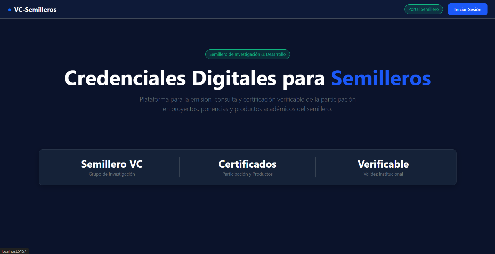

# Functional Proof

## 1. Front construido

**Pantallas** 

**Home** HU-C05-01: 

El sistema cumple con la HU, ya que permite al usuario institucional autenticarse en el portal y operar únicamente según los roles que tiene vigentes, restringiendo el acceso a las funciones que no le corresponden.

**Gestion Semilleros** HU-C05-02: 

Se cumple con la HU, ya que el portal permite al administrador institucional gestionar semilleros y periodos a través de los contratos de C02 (CA1), sin acceder directamente a su almacenamiento (CA3). Además, el portal muestra los estados y errores de gobierno devueltos por C02, como rechazos por regla o indisponibilidad del servicio, sin simular éxito (CA2).

**Gestion Asistencia vigente y validacion** HU-C05-03: 

Se cumple con la HU en lo principal, ya que el módulo permite al responsable del semillero registrar y consultar la asistencia de los participantes por sesión, identificando la fecha, el tema y el participante con su documento (CA2). La interfaz separa el registro de asistencia de la evaluación de elegibilidad, que se ejecuta en una sección distinta, por lo que registrar asistencia no declara automáticamente al participante como elegible (CA1).

**Gestion Emision Autorizado de Credenciales** HU-C05-05: 

Le da al emisor la posibilidad de pedir la credencial de un participante que el decida del semillero, con el objetivo de ejecutar el flujo gobernado en una interfaz controlada.

**Consulta de Credenciales** HU-C05-06: 

Se cumple con la HU, ya que el participante puede consultar en el portal su credencial emitida, con su información esencial (identificador, titular, institución y fecha de emisión) y su estado actual “Válida”, asociada a su perfil y con un hash y código QR que respaldan la integridad del documento.

**Consultar Auditoria** HU-C05-08: 

Cumple con la HU al dar un enlace oficial del certificado, siendo adjuntable a tu CV o perfil profesional para que se pueda comprobar su validez técnica según los permisos que haya dado el titular.

## 2. Decisión técnica

**Opción elegida: B. Solución existente del ecosistema Stellar, sin contrato propio.**

Para el desarrollo de VC Semilleros se ha decidido utilizar las capacidades nativas de Stellar Testnet, sin implementar contratos inteligentes propios durante esta etapa. Esta decisión responde al alcance del MVP definido en el Product Blueprint, cuyo propósito es permitir la emisión y verificación de credenciales académicas a partir de los registros de asistencia y del cumplimiento de los criterios establecidos para los participantes de los semilleros de investigación.

La solución se desarrollará utilizando C# como lenguaje de programación, .NET como plataforma de desarrollo, Blazor para la construcción de la interfaz web y ASP.NET Core para los servicios del backend. La arquitectura estará organizada en componentes responsables de la interoperabilidad de credenciales bajo estándares W3C, la gestión de asistencia y emisión, la verificación y confianza, y el control de estados y auditoría. Para la persistencia de la información se utilizará PostgreSQL, donde se almacenarán los registros de asistencia, las solicitudes, las credenciales y demás datos necesarios para el funcionamiento del sistema.

En esta arquitectura, Stellar Testnet se utilizará como mecanismo de anclaje criptográfico para registrar evidencias que permitan comprobar la integridad de la información y fortalecer su trazabilidad. La integración se realizará mediante un adaptador de infraestructura desarrollado en C#, encargado de establecer la comunicación con la red Stellar. Esta separación permitirá mantener la lógica de negocio independiente de la tecnología blockchain.

Las credenciales, los datos personales, las reglas de elegibilidad y los registros operativos permanecerán en PostgreSQL, mientras que en Stellar se registrarán evidencias criptográficas, sin almacenar documentos completos ni información personal. El formato específico de estas evidencias se definirá durante la implementación.

Se descarta, por ahora, el desarrollo de contratos inteligentes propios con Soroban, debido a que las funcionalidades previstas para el MVP no requieren ejecutar reglas de negocio directamente en blockchain. Su incorporación supondría mayor complejidad de desarrollo, mantenimiento y validación de seguridad, sin una necesidad funcional que lo justifique en esta etapa.

Esta decisión permite concentrar los esfuerzos en los procesos de asistencia, elegibilidad, emisión y verificación, aprovechando las capacidades existentes del ecosistema Stellar. La alternativa podrá reconsiderarse si posteriormente surgen requisitos que justifiquen el uso de contratos inteligentes.

## 3. Participación del equipo

| Integrante / GitHub | Aporte documental propuesto | 
|---|---|
| Andres Bedoya | Perfil de credenciales y responsabilidades de firma e interoperabilidad | 
| Juan Pablo Acevedo | Flujo de asistencia, elegibilidad y autorización | 
| Alexandra Guerrero | Verificación compuesta y límites del anclaje blockchain | 
| Isabella Bohada | Decisión Stellar Testnet, trazabilidad y auditoría | 
| Valeria Rivera | Inventario del portal, README y consolidación de documentación | 

## 4. Bloqueos y siguiente paso

El siguiente paso consiste en implementar el backend con sus reglas de negocio y la articulación con Stellar

